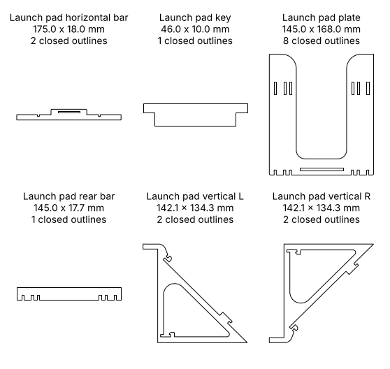

# Drone launcher (launch pad)

Laser-cut launch pad for a 5" drone, 45° launch angle. Designed in Autodesk Fusion by Team UVIRA.

## Parts (all GFRP 3 mm, qty 1 each)

| Part | Outline (mm) | DXF | 3D (STEP) |
|---|---|---|---|
| Plate | 145.0 × 168.0 | `dxf/Launch pad plate - GFRP 3mm - qty 1.dxf` | `step/Launch pad plate - GFRP 3mm - qty 1.step` |
| Vertical L | 142.1 × 134.3 | `dxf/Launch pad vertical L - GFRP 3mm - qty 1.dxf` | `step/Launch pad vertical L - GFRP 3mm - qty 1.step` |
| Vertical R (mirror of L) | 142.1 × 134.3 | `dxf/Launch pad vertical R - GFRP 3mm - qty 1.dxf` | `step/Launch pad vertical R - GFRP 3mm - qty 1.step` |
| Rear bar | 145.0 × 17.7 | `dxf/Launch pad rear bar - GFRP 3mm - qty 1.dxf` | `step/Launch pad rear bar - GFRP 3mm - qty 1.step` |
| Horizontal bar | 175.0 × 18.0 | `dxf/Launch pad horizontal bar - GFRP 3mm - qty 1.dxf` | `step/Launch pad horizontal bar - GFRP 3mm - qty 1.step` |
| Key | 46.0 × 10.0 | `dxf/Launch pad key - GFRP 3mm - qty 1.dxf` | `step/Launch pad key - GFRP 3mm - qty 1.step` |

Full assembly: `step/Drone launch pad assembly.step`

## Fit
- All slots for 3 mm sheet are 3.2 mm (0.1 mm clearance each side) so parts slide together.
- Verticals can sit in 3 positions (inner / middle / outer); plate and rear bar have matching slots.
- DXF units: millimetres, true size, closed polylines (ready for laser).

## Viewing the files
- DXF: LibreCAD (free), or online at https://sharecad.org or https://viewer.autodesk.com
- STEP: Autodesk Viewer (online), FreeCAD (free), or Fusion.

## Changelog
- 2026-11-26: slots widened to 3.2 mm, extra rear-bar slots for inner/outer vertical positions, horizontal bar ends squared (+5 mm each side), vertical L mirrored from updated vertical R.
